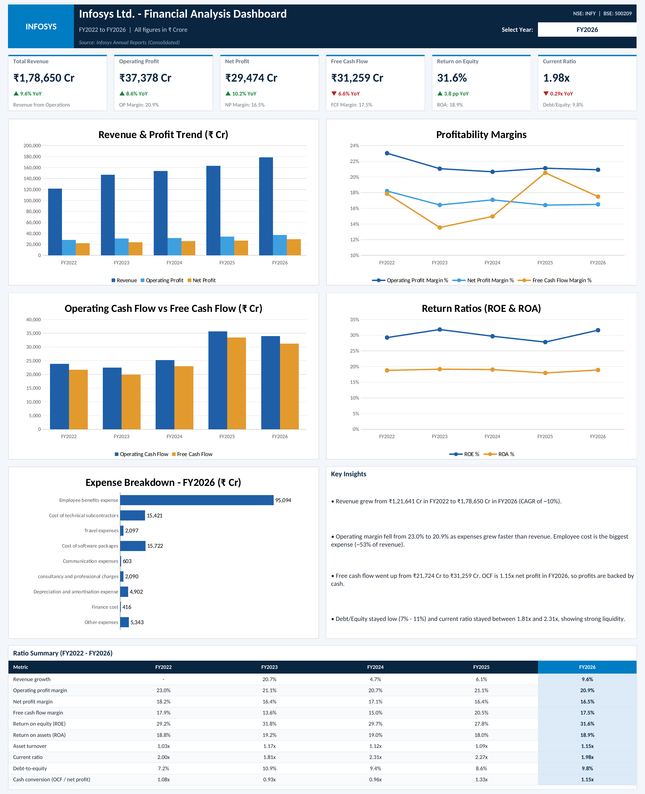

# Infosys Financial Analysis Dashboard (FY2022 – FY2026)

Financial statement analysis of Infosys Ltd. for five years (FY2022 to FY2026), built in Microsoft Excel. The project covers the P&L, balance sheet and cash flow statement, calculates key financial ratios, and presents the results in a one-page dashboard.

## Data
- Source: Infosys Annual Reports (Consolidated)
- Period: FY2022 to FY2026
- All figures in ₹ Crore unless mentioned

## Workbook Structure
| Sheet | Description |
|---|---|
| Dashboard | KPI cards, trend charts, expense breakdown, key insights and ratio summary |
| P&L Statement | Five-year profit and loss statement |
| Balance Sheet | Five-year balance sheet |
| Cash Flow Statement | Operating, investing and financing cash flows |
| Analysis | Growth, profitability, return, liquidity, leverage and cash flow ratios |
| Analysis & Insights | Commentary on each ratio |
| Advanced Excel Analysis | Dynamic lookup, financial health check, SUMIFS / COUNTIFS / AVERAGEIFS, Goal Seek |
| Pivot Table | Operating expense pivot with slicer and chart |

## Dashboard Highlights
- **Year selector:** choose a year from the dropdown to update the KPI cards and the highlighted column in the ratio summary
- **KPI cards:** Revenue, Operating Profit, Net Profit, Free Cash Flow, ROE and Current Ratio with year-on-year change
- **Charts:** Revenue & profit trend, profitability margins, operating vs free cash flow, ROE & ROA, expense breakdown
- **Ratio summary:** five-year view of the key ratios

## Key Insights
- Revenue grew from ₹1,21,641 Cr in FY2022 to ₹1,78,650 Cr in FY2026 (CAGR of ~10%).
- Operating margin declined from 23.0% to 20.9% as expenses grew faster than revenue. Employee cost is the largest expense (~53% of revenue).
- Free cash flow increased from ₹21,724 Cr to ₹31,259 Cr. Operating cash flow was 1.15x net profit in FY2026, showing good cash conversion.
- Debt-to-equity stayed low (7% – 11%) and the current ratio remained between 1.81x and 2.31x, showing a strong liquidity position.

## Excel Skills Used
Financial statement analysis, ratio analysis, INDEX/MATCH, XLOOKUP, SUMIFS, COUNTIFS, AVERAGEIFS, pivot tables, slicers, data validation, conditional formatting, charts, Goal Seek

## How to Use
1. Download `Infosys_Financial_Analysis.xlsx`
2. Open it in Microsoft Excel (click **Enable Editing** if prompted)
3. On the Dashboard sheet, select a year from the dropdown next to "Select Year"
